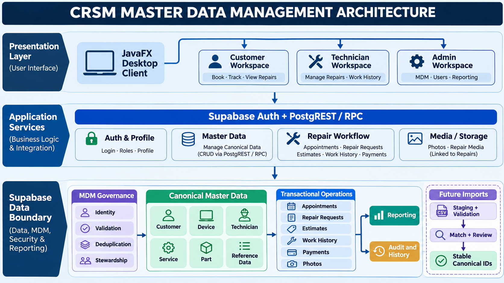
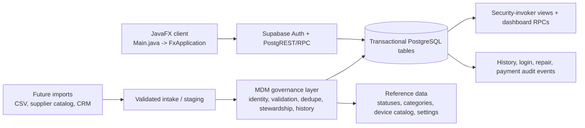
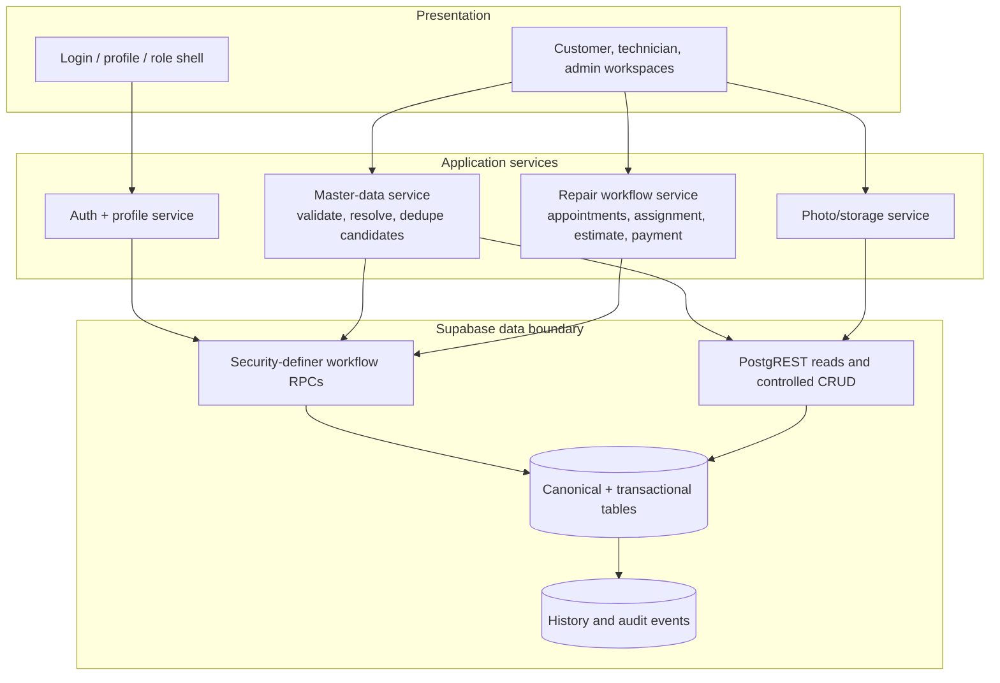
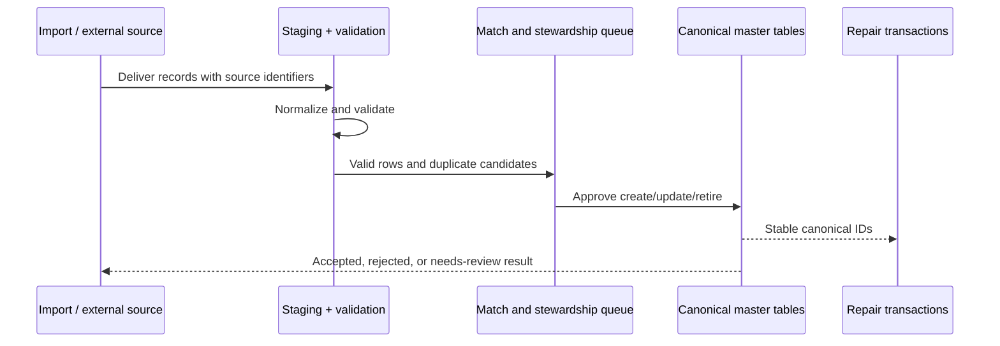

# CRSM Master Data Management Architecture

Status: proposed architecture  
Scope: Customer, device, technician, service, part, and shop-reference master data for the CRSM desktop application.  
Current entry point: [Main.java](../src/Main.java)

## 1. Architectural intent

The system should treat Supabase/PostgreSQL as the operational source of truth. The MDM capability sits around that system to keep shared business entities accurate, deduplicated, governed, and safe to reuse across appointments, repair requests, estimates, work history, billing, reporting, and customer self-service.

MDM does not replace transactions. A customer, device, technician, service, or part is master data. An appointment, repair request, diagnosis, payment, photo, estimate decision, or work entry is a transaction or event that references master-data IDs.

## 2. Master domains

### Customer master

Canonical record: `public.customers`, linked to `public.crsm_profiles` through `auth_user_id`.

Rules:

- `customer_id` is the stable internal identifier; email and username are not business foreign keys.
- A customer account may own one customer record; profile and customer edits must preserve the link.
- Contact and address changes are governed profile updates, not new customer creation.
- Duplicate candidates should be detected using normalized email, phone, and a conservative name/address comparison; never merge automatically when active repairs or payments exist.

### Device master

Canonical record: `public.computers`; catalog reference: `public.crsm_device_catalog`.

Rules:

- A device belongs to one customer and keeps its stable `computer_id` across repairs.
- Brand/model/type selections should come from the catalog where possible; free text remains allowed for legacy or unsupported equipment.
- Serial number is a matching signal, not a universal key because refurbished, missing, or shared devices may violate uniqueness assumptions.
- Intake-specific symptoms, condition, accessories, and verified specification belong to the repair/intake history, not the reusable device identity.

### Technician master

Canonical record: `public.technicians`, linked to an active Staff profile through `auth_user_id`.

Rules:

- Duty status is manually managed; effective availability is derived from duty status plus active repair workload.
- Assignment capacity must be decided by the validated RPC, not by generic CRUD.
- Deactivation must not silently delete historical assignments or work entries.

### Service master

Canonical record: `public.repair_services`; compatibility and pricing extensions include device-pricing and part-price tables.

Rules:

- `service_id` is stable and referenced by repair requests.
- Service name, category, description, common problems, and replacement-part requirements are stewarded fields.
- Prices must be versioned or historically captured when used in an estimate; a later catalog-price edit must not rewrite a completed repair bill.
- Inactive services should be retired from selection rather than deleted.

### Part master

Canonical record: `public.repair_service_part_prices` plus the service/device compatibility dimensions.

Rules:

- Separate canonical part identity from supplier offers and observed prices when supplier integration is introduced.
- Never treat a live supplier listing as authoritative shop pricing without approval.
- Preserve the source, effective date, currency, and active flag for every imported or manually entered price.

### Shop and reference master

Canonical records: `public.crsm_settings`, service categories, device types, repair statuses, appointment statuses, payment methods, and role values.

Rules:

- Values used by UI choice controls and database checks must be defined once and documented.
- Status transitions are workflow rules, not ordinary master-data edits.
- A displayed label may change, but persisted codes should remain stable.

## 3. Target logical layers

## 4. Golden-record lifecycle

1. **Capture** — receive a signup, profile edit, catalog edit, admin entry, or future import.
2. **Normalize** — trim whitespace, normalize email casing, normalize phone comparison digits, standardize status/category codes, and preserve the original display value where needed.
3. **Validate** — enforce field length, required fields, allowed values, ownership, role, and referential integrity before persistence.
4. **Match** — search existing records using deterministic keys first, then produce a duplicate candidate for steward review.
5. **Resolve** — accept the existing record, create a new record, or merge only with explicit stewardship approval.
6. **Publish** — make the canonical ID and approved attributes available to the application through authenticated reads/RPCs.
7. **Audit** — record who changed what, when, and why; preserve transaction history even when master attributes later change.

## 5. Ownership and stewardship

- **Customer profile**: customer owns personal contact details; Admin handles account linking, activation, and role administration.
- **Device identity**: customer supplies intake details; technician verifies specification and condition during repair.
- **Technician identity and duty status**: Admin owns; workload-derived availability is system-calculated.
- **Services, categories, compatibility, and prices**: Admin/service steward owns; technicians may propose changes but should not silently publish them.
- **Parts and supplier observations**: Admin/service steward owns; imported values remain staged until approved.
- **Appointments and repair workflow**: transactional workflow ownership; not editable through generic master CRUD once operationally referenced.

## 6. Data-quality controls

Minimum controls for the next implementation phase:

- Unique or conditionally unique normalized identifiers for profile email, username, linked auth user, and technician/auth links.
- Duplicate-candidate queries for customers, devices, services, and parts.
- Required `created_at`, `updated_at`, `created_by`, `updated_by`, and optional `source_system` metadata on new master tables or extensions.
- Soft retirement (`active`/`retired_at`) for services, parts, catalog values, technicians, and devices; avoid destructive deletion of referenced records.
- Effective-dated service and part prices so historical estimates and completed bills remain reproducible.
- Referential checks that appointment customer and computer agree, and that a repair request's device belongs to the same customer scope.
- Import quarantine: invalid rows never reach canonical tables; rejected rows retain reason codes for correction.

## 7. Security boundary

- The JavaFX client never becomes the authority for ownership, role, assignment capacity, payment authorization, or workflow transitions.
- Customer reads are limited to owned customer/device/appointment/repair/payment data.
- Staff reads are limited to assigned repairs where the business rule requires assignment scope; Admin has shop-wide scope.
- Security-sensitive writes use authenticated RPCs with server-side authorization and transition validation.
- Storage paths are scoped to the signed-in user and repair ID, with metadata authorization checked before download.
- Reports and views must remain security-invoker so their base-table policies are preserved.

## 8. Integration and synchronization pattern

The current application is synchronous request/response. If imports or external systems are added, use this sequence:

For future reliability, add an outbox/event publication mechanism after committed master changes rather than making the UI poll every source independently. Events should be idempotent and keyed by canonical entity ID plus version.

## 9. Delivery plan

### Phase 1 — contract and inventory

- Freeze canonical entity names, IDs, status codes, and ownership rules.
- Document migration order and remove duplicate function definitions across SQL files.
- Add read-only data-quality reports for duplicate candidates, orphan links, invalid statuses, and inconsistent customer/device ownership.

### Phase 2 — governance metadata

- Add master-data change history and source metadata.
- Add active/retired lifecycle fields where current delete behavior would damage history.
- Add Admin stewardship screens for approve, retire, and resolve-duplicate actions.

### Phase 3 — ingestion and publishing

- Add staging tables and import validation for service/device/parts catalogs.
- Add idempotent upsert procedures keyed by source-system identifiers.
- Add canonical-change events for future reporting or integrations.

### Phase 4 — operational hardening

- Add end-to-end tests for duplicate prevention, concurrent edits, stale updates, role scope, and historical price reproducibility.
- Monitor rejected imports, unresolved duplicate candidates, failed RPCs, and stale reference data.

## 10. Decisions for implementation

- Keep Supabase/PostgreSQL as the first MDM implementation; do not introduce a separate MDM product until data volume or integration count justifies it.
- Keep repair requests, appointments, work entries, payments, photos, and history as transactional data linked to immutable master IDs.
- Add governance and staging capabilities incrementally around the existing schema rather than rewriting the working workflow.
- Treat all proposed MDM schema changes as migrations requiring a separate test database and explicit approval; this document makes no database changes.
